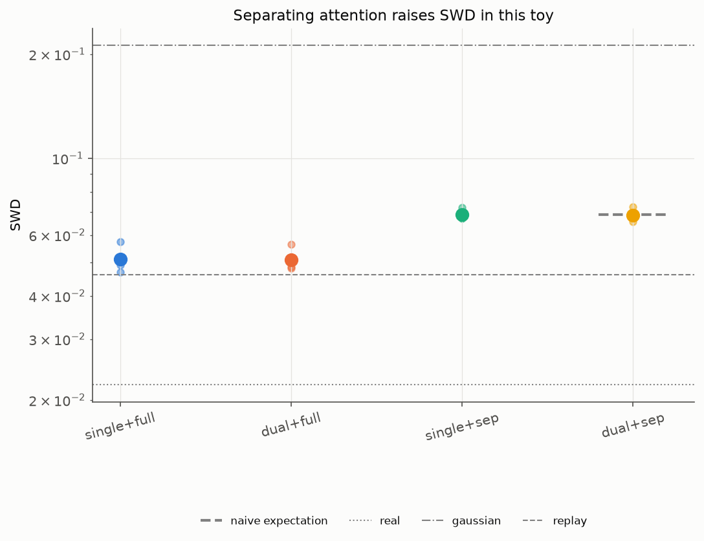
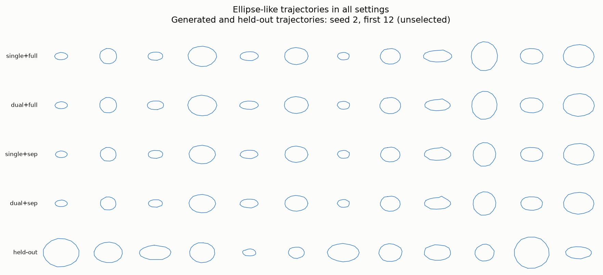
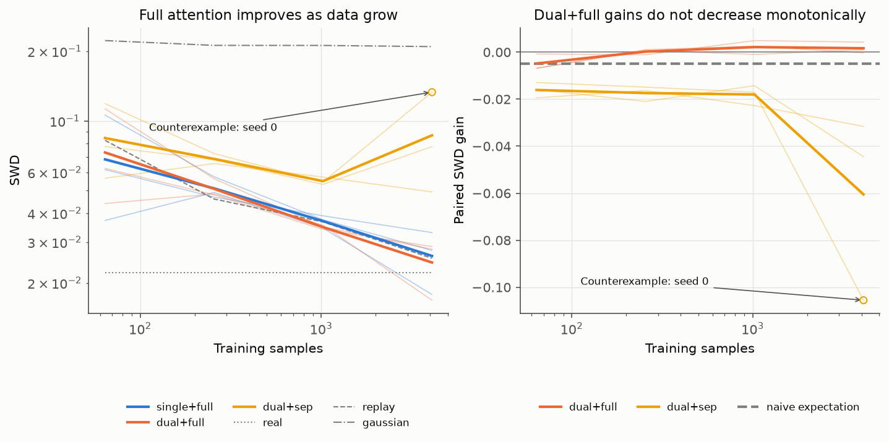
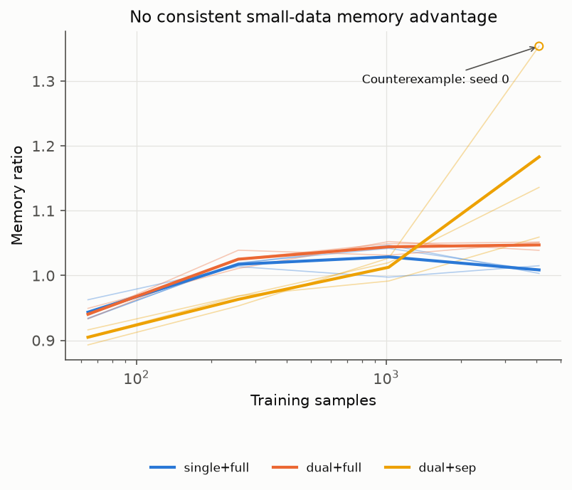
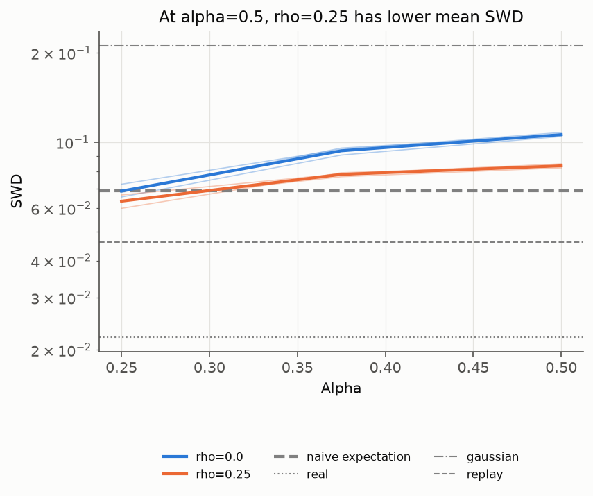

# SRA → Self-Flow：双时间步收益未形成清晰的增强证据

topic：2026-11-15-sra-selfflow-augmentation · [计划](PLAN.md) · [发现重建](DISCOVERY.md)
状态：executed（66 次正式训练与核验完成，待 Reviewer 复盘） · 对应发现链：注意力切断、数据量、训练–采样不一致。

**一句话结论**：本 toy 未呈现“小数据上 DTS 收益最大、数据增多后衰减”的预言；分组注意力代价明显。增大 mask 比例使 SWD 恶化，整图混合能缓解，但未达到冻结的恢复阈值。

## 结论先行

- **E1：DTS 收益来源无法判定**。full 和 sep 内 single→dual 的平均改善都只有约 0.00023，且配对差跨零；切断注意力本身的代价更明显。[图](figures/E1_main.png)
- **E2：不支持预定的增强形状**。dual+full 的收益从小 n 的负值变为很小的正值，并非从小数据优势单调趋零；dual+sep 在全部数据量、全部 seed 上均差于 single+full。[图](figures/E2_main.png)
- **记忆指标没有一致的小数据优势**。尤其不能把较低 SWD 或 mem≈1 单独当作“增强机制成立”。[图](figures/E2_mem.png)
- **E3：大 mask 的代价和混合的缓解都可见**。α=0.5、ρ=0 的 SWD 是基准的 1.549 倍；混合后为基准的 1.217 倍，仍高于预言的 1.2 倍上限。[图](figures/E3_main.png)

所有表格均为 seeds 0/1/2 的 mean [min–max]；SWD 越低越好。min–max 仅描述这三个 seed，不是置信区间。

## E1 切断跨噪声注意力后，双时间步收益是否保留？

**冻结预测**：用户预测“双时间步+AS 比不切断更好”；agent 预测 dual+sep 接近 dual+full，且两者均不差于 single+full，同时预留 DTS 收益不可分辨的可能。



**怎么读这张图**：先比较每种 attention 内的 single/dual，再比较 full/sep。小点是全部 seed，大点是均值；灰虚线标出 single+sep 的朴素预期。若观察到明确的 dual+full 优势而 dual+sep 退回基线，才符合 PLAN 的机制推翻条件；本次先缺少明确的 DTS 优势。

| 条件 | SWD mean [min–max] | mem mean [min–max] |
|---|---|---|
| single+full | 0.05115 [0.04690–0.05741] | 1.0173 [1.0138–1.0197] |
| dual+full | 0.05091 [0.04801–0.05634] | 1.0252 [1.0110–1.0391] |
| single+sep | 0.06879 [0.06701–0.07206] | 0.9688 [0.9635–0.9786] |
| dual+sep | 0.06855 [0.06546–0.07229] | 0.9633 [0.9531–0.9688] |

full 内的配对收益 single−dual 为 0.000231 [−0.001109–0.001067]；sep 内为 0.000243 [−0.000883–0.001846]。dual+sep 与 dual+full 的均值差为 0.01763，大于二者各自的 seed 范围宽度 0.00683 和 0.00834。

**与预测对比**：用户关于切断后更好的方向未出现；agent 关于两种 dual 条件相当的数量关系也未成立。但预定的机制推翻条件要求先有清晰的 dual+full 收益，该前提未满足，不能据此判定 DTS 来自增强还是跨噪声交互。



**怎么读样本图**：使用 dual+sep SWD 最接近中位数的 seed 2；每格取同批噪声生成的前 12 条，不挑样本，最后一行是真实 held-out。各图同轴范围；形状都像椭圆并不意味着整体分布或 SWD 相同。

**解释与边界**：toy 实测支持“此设置中 sep 的代价大于 DTS 的可见收益”；它不支持“真实图像上的异质噪声交互无用”。

## E2 数据越多，收益越小吗？

**冻结预测**：用户预测收益逐渐变大；agent 预测 n=64 的收益最大，n=4096 时接近零。



**怎么读这张图**：左图比较 SWD 和三个参照；右图是同 seed 的 G=SWD(single+full)−SWD(dual)。右图正值表示收益。增强预言要求从小 n 的正收益单调趋零；灰虚线是与数据量无关的朴素预期。细线保留每个 seed，反例 seed 0 已标注。

| n | single+full SWD | dual+full SWD | dual+sep SWD |
|---|---|---|---|
| 64 | 0.06823 [0.03718–0.10590] | 0.07307 [0.04401–0.11281] | 0.08433 [0.05662–0.11883] |
| 256 | 0.05115 [0.04690–0.05741] | 0.05091 [0.04801–0.05634] | 0.06855 [0.06546–0.07229] |
| 1024 | 0.03695 [0.03448–0.03894] | 0.03481 [0.03402–0.03547] | 0.05497 [0.05320–0.05722] |
| 4096 | 0.02612 [0.01780–0.03296] | 0.02448 [0.01683–0.02868] | 0.08664 [0.04938–0.13312] |

| n | dual+full 配对收益 G | dual+sep 配对收益 G |
|---|---|---|
| 64 | −0.004840 [−0.006908–−0.000782] | −0.016095 [−0.019434–−0.012929] |
| 256 | 0.000231 [−0.001109–0.001067] | −0.017401 [−0.020997–−0.014879] |
| 1024 | 0.002148 [−0.000985–0.004919] | −0.018019 [−0.022733–−0.014262] |
| 4096 | 0.001644 [−0.000325–0.004280] | −0.060520 [−0.105514–−0.031575] |

**与预测对比**：agent 的“小 n 收益最大且随 n 衰减”未出现。用户预测仅在 dual+full 从 n=64 到较大 n 的总体方向上接近结果，严格单调和 dual+sep 的方向均不成立。n=4096 的 full 收益仍小于其配对 seed 范围，不能夸大为稳定的大数据优势。



**怎么读 mem 图**：n=64 时三条件的 mem 均值分别为 0.9434、0.9404、0.9048，没有 dual 条件一致更接近 1 的模式。n=4096 的 dual+sep 均值 1.1830 受高值 seed 影响；mem>1 也可能来自生成分布偏差，不能简单等同更好泛化。全部逐 seed 值和 min–max 均保存在 E2.json。

**解释与边界**：这不支持本 toy 中预定的增强签名，也不证明另一机制正确。E2 缺少随 n 变化的 single+sep 对照，因此 dual+sep 对 single+full 的差异不能单独归因于双时间步。固定 1500 步还使各数据量的样本重复次数不同，不能当作优化充分时的渐近结论。

## E3 mask 比例与训练–采样不一致

**冻结预测**：用户预测基本不变；agent 预测 α=0.5、ρ=0 的 SWD 至少是 α=0.25 的 1.5 倍，且 ρ=0.25 能将其压到基准的 1.2 倍以内。



**怎么读这张图**：先看蓝线是否随 α 上升，再看橙线能否变平并回到 α=0.25、ρ=0 的灰虚线附近。粗线是均值，细线为全部 seed；两条线均上升，混合后的斜率较小。混合带来改善不等于达到预定的恢复水平。

| α | ρ | SWD mean [min–max] | mem mean [min–max] |
|---|---|---|---|
| 0.25 | 0 | 0.06855 [0.06546–0.07229] | 0.9633 [0.9531–0.9688] |
| 0.25 | 0.25 | 0.06336 [0.05994–0.06651] | 0.9768 [0.9685–0.9869] |
| 0.375 | 0 | 0.09369 [0.09063–0.09570] | 0.9323 [0.9264–0.9382] |
| 0.375 | 0.25 | 0.07801 [0.07663–0.07904] | 0.9563 [0.9461–0.9661] |
| 0.5 | 0 | 0.10617 [0.10469–0.10799] | 0.9222 [0.9132–0.9325] |
| 0.5 | 0.25 | 0.08340 [0.08207–0.08469] | 0.9525 [0.9356–0.9698] |

**与预测对比**：用户“基本不变”的方向未出现。agent 的恶化阈值命中：0.106170/0.068547=1.548877≥1.5；恢复幅度未命中：0.083401/0.068547=1.216708>1.2。冻结基准为 α=0.25、ρ=0，1.2 倍对应 SWD=0.082256，实际高出约 0.001145；不能改阈值使其过关，也不把这个接近边界的差距夸大。相对混合自己的 α=0.25 基准，α=0.5 仍恶化约 31.6%，所以橙线也并未持平。

**解释与边界**：toy 实测支持“更大的 mask 比例有代价，混入整图样本可部分缓解”的模式。训练–采样不一致是与该结果一致的解释，但 α 也改变了训练时可见上下文大小，混合也改变了训练输入分布；本实验不足以证明不一致是唯一原因。

## 意外与反例

- n=4096、dual+sep、seed 0 的 SWD=0.133122、mem=1.353755；同条件 seed 1/2 的 SWD 为 0.049380/0.077430。它显著拉高均值、扩大 seed 范围，已保留并在全 seed 图标为反例，未重跑或排除。
- 即使不看该偏离 seed，其余两个 seed 的 G 仍为负；因此“dual+sep 没有正收益”的符号不由它单独决定，但恶化幅度的不确定性很大。
- PLAN 称为“真实下限”的参照是两批有限真实样本之间的 SWD，不是严格硬下界。个别模型低于该线不代表超越真实分布。

## 这个 toy 能说明什么、不能说明什么

- **toy 实测**：在固定模型、数据、1500 步和这三个 seed 下，分组注意力的代价清晰，DTS 收益很小或为负，预定的数据量签名未出现；更大 mask 的代价和整图混合的部分缓解可见。
- **推断**：这套 toy 缺少可辨认的正 DTS 效应，因此区分其来源的辨识力不足；不能把“未观察到收益”写成“机制不存在”。
- **论文层面**：本次不复现论文 FID/IS，也不验证真实图像、大模型、大数据或外部编码器 REPA 的情形。token 只有 16 个、结构简单，噪声交互的重要性可能与图像不同。

## 下一步（最多 3 条）

1. 交给新的 Reviewer 会话核对冻结预测并与用户复盘，状态保持 executed，尚不进入 reviewed。
2. 复盘时区分“DTS 没有可辨认的收益”与“已经证明某个收益机制”；taste 判断保留给用户，不代写。
3. 如需新实验，另行规划并冻结预测；不借本次结果追调步数、超参或 seed。

## 复现

机器 pc / WSL2，CPU 4 线程，显存用量 0；无下载、无安装。Python 3.12.3，torch 2.11.0+cu128，numpy 2.5.4，matplotlib 3.11.2。所有编程由 gpt-6.1-terra、medium 完成。

- 用户明确批准本 topic 的 CPU 总预算为 120 分钟；PLAN 末尾记录修订，全局 lab.toml 仍为 30 分钟。
- 正式 E1 617.92 秒、E2 1851.69 秒、E3 936.89 秒，合计 3406.50 秒（56.78 分钟）；加完整 smoke 39.17 秒、原停止 smoke 训练 3.56 秒及绘图收尾 10.24 秒，约 57.66 分钟，未超过 120 分钟。开发与网络等待不计作计算时间。
- [E1.json](results/E1.json)、[E2.json](results/E2.json)、[E3.json](results/E3.json) 均为 done，分别含 12/36/18 条正式指标；保存逐 seed 指标、基线、mean/min–max、完整参数、环境和运行时间。
- 正式快照含两份代码文件；三个 run_id 分别为 `E1-20261116-034550-pc`、`E2-20261116-035711-pc`、`E3-20261116-043058-pc`。原始产物位于 `pc:/home/pc/lab/runs/2026-11-15-sra-selfflow-augmentation/<run_id>/`，登记见 results/runs/。

在各快照的 `topics/2026-11-15-sra-selfflow-augmentation/` 下运行（E2/E3 分别换编号、预算和 prior；不覆盖已有 state，恢复用同一快照加 --resume）：

```bash
MPLCONFIGDIR=/tmp/sra-mpl /home/pc/lab/envs/main/bin/python code/run.py --exp E1 --seeds 0 1 2 --threads 4 --topic-budget-minutes 120 --experiment-budget-minutes 20 --prior-runtime-sec 43 --workspace-root /home/pc/lab/coding_agent_repro
```

E2 的 experiment-budget-minutes=60、prior-runtime-sec=661；E3 分别为 30、2513。入口参数均已登记在对应运行记录。只重绘仓库中的结果、不训练或更改 JSON：

```bash
MPLCONFIGDIR=/tmp/sra-mpl /home/pc/lab/envs/main/bin/python topics/2026-11-15-sra-selfflow-augmentation/code/run.py --exp E1 --plot-only
```

## 执行记录

- 启动前已 git pull、status，并读取 EXPERIMENTS/LEARNING。原 smoke 触发 30 分钟门控后停下，用户于 2026-11-16 批准 120 分钟例外后才继续；模型、步数、seed、冻结预测不变。
- 既存目录 `topics/2026-11-14-e2e-smoke` 仅存本机自检图和日志，已在索引补登记为 abandoned；没有移动、删除或改写其产物。
- 恢复预检包含 E1 四格的 seed 0、100 步及完整采样/指标/绘图，通过后才进入 running。正式实验用 lab.py run start/end 和 tmux，逐条件保存指标、EMA 与样本。
- 三份结果的条数、条件、seed、非有限值、基线、汇总和 E2 配对收益均已校验；E1↔E2 的 9 条重复条件和 E1↔E3 的 3 条重复条件一致。五张正式图均已实际打开检查，每张小于 1 MB。代码 AST、JSON 和 whitespace 检查通过，未为结果调参、挑 seed 或改指标。
- 正式数据使用各 run 记录所指提交的代码。后续只改仓库的绘图和 --plot-only 入口，以修复图例遮挡、标记反例；原始图留在各运行目录。重绘前后 E1/E2 指标 SHA256 不变；恢复训练须使用原快照，不能将新代码混入旧 state。
- DISCOVERY、冻结预测和 REFLECTION 未修改；INSIGHTS、RESEARCH_MOVES、LEARNING 的复盘更新留给 Reviewer。
- `lab.py check topics/2026-11-15-sra-selfflow-augmentation --phase executed` 通过：0 ERROR、0 WARN；索引推进为 executed，未推进为 reviewed。完整核验报告在本机 `runs/_validation/final.json`，对应只读核验脚本为 `runs/_validation/validate.py`。
