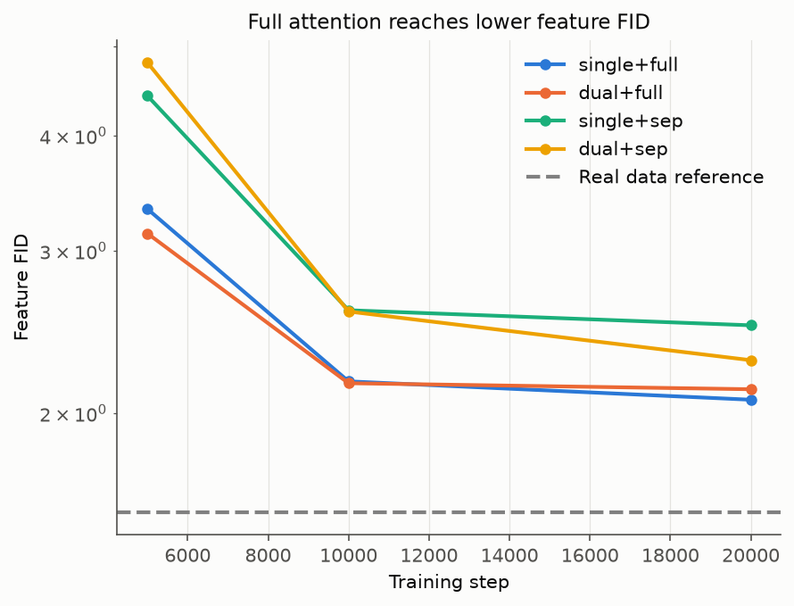
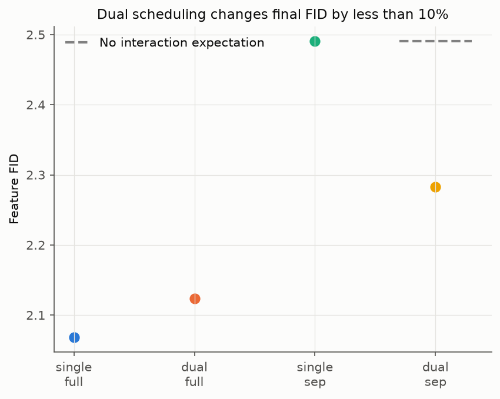
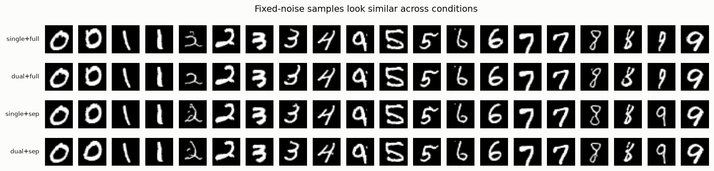
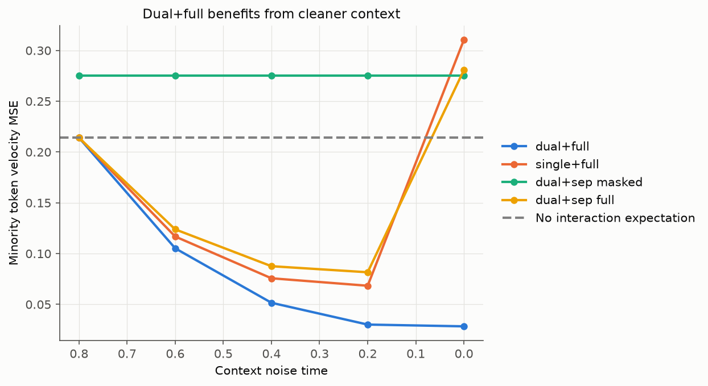

# From SRA to Self-Flow — MNIST L2：结果与结论

topic：2026-11-16-sra-selfflow-mnist · [计划](PLAN.md) · 状态：executed

**一句话结论**：单 seed 的 MNIST toy 中，双时间步未带来预设阈值下明显的 FID 改善；但在独立的上下文探针里，dual+full 模型对干净上下文有强烈响应。

## 结论先行

- [E1 曲线](figures/E1_curve.png)：四组 FID 随训练降低；本次完整注意力两组在三个检查点都低于各自的分组注意力组。
- [E1 终点](figures/E1_final.png)：完整注意力下 dual 与 single 的 FID 相差 2.65%；分组注意力下相差 9.10%，均不超过预先指定的 10% 阈值。后者靠近阈值，不能作稳健判断。
- [E2 探针](figures/E2_main.png)：上下文从 t=0.8 变到 0 时，dual+full 的少数组速度 MSE 降低 86.74%；切断跨组注意力的对照完全水平。
- [固定噪声样本](figures/E1_samples.png)可辨认各类别，但样本图无法替代上述定量比较。

## E1：双时间步是否改善生成质量？

**预测**：用户预测 dual+full 明显更好、dual+sep 与 dual+full 相当；agent 预测 dual+full 与 single+full 差不多，dual+sep 明显差于 dual+full、但不超过其 1.5 倍。

**怎么读**：横轴为训练迭代，纵轴为分类器特征 FID（越低越好，对数轴）；灰线是真实训练图对测试图的参照。四组在 20000 步的 FID 均高于真实参照 1.561，且不能与论文 FID 比较。

| 条件 | 20000 步 FID ↓ | 条件分类准确率 ↑ |
|---|---:|---:|
| single+full | 2.0684 | 97.70% |
| dual+full | 2.1233 | 97.74% |
| single+sep | 2.4908 | 98.45% |
| dual+sep | 2.2830 | 98.30% |

**怎么读**：灰色虚线为朴素预期的 single+sep 终点。预设相对差为 `|a−b| / min(a,b)`：dual+full 相对 single+full 为 2.65%，dual+sep 相对 single+sep 为 9.10%，dual+sep 相对 dual+full 为 7.52%，按 10% 阈值均为相当；其中 9.10% 靠近未经校准的阈值。single+sep 比 single+full 高 20.42%，这反映本次完整/分组注意力对照，但不单独证明双时间步的作用。

**与预测对比**：用户对明显收益的预测未获支持，两个双时间步与单时间步对照均未越过 10%；用户对两个 dual 条件相当的预测与结果一致。agent 对 E1a“差不多”的预测一致；E1b 预测 dual+sep 明显更差未获支持，尽管它低于 1.5 倍的附加条件成立。因 dual+full 未明显优于 single+full，E1 不足以判定计划中的增强假设或交互解释。

**怎么读**：每行对应一种条件，每类取固定噪声的前两张，不挑选；图片展示能否辨识数字及个体差异，不证明细小 FID 差距可靠。

## E2：干净上下文是否改变嘈杂 token 的误差？

**预测**：用户预测误差大幅下降；agent 预测 dual+full 至少下降 50%，single+full 也下降但幅度更小。

**怎么读**：横轴从左至右代表上下文逐渐变干净，纵轴是固定在 t=0.8 的少数组速度 MSE。灰虚线是 dual+full 起点的“无变化”参照；分组掩码对照固定在 0.27549，五个点完全一致，满足误差变化不超过 1% 的实现检查。

dual+full 从 0.21412 降至 0.02839，下降 86.74%，与用户“大幅下降”和 agent 的主预测一致。single+full 虽在中间时刻下降，但 t=0 时升至 0.31047，比起点高 44.86%，不符合 agent“终点也下降”的附加预测；dual+sep 用完整注意力时终点也比起点高 31.17%。这一受控探针支持 dual+full 模型会利用更干净上下文，但不能证明这种交互是 E1 生成质量变化的原因。

## 意外与反例

single+full 与 dual+sep/full 两条探针曲线在完全干净的上下文处反弹；不能只展示中间下降区间来概括整个趋势。E1 在本次 seed 中没有出现预设意义上的双时间步明显收益。

## 这个 toy 能说明什么、不能说明什么

- **toy 实测**：上述是一个 MNIST 小 DiT、单 seed、固定设置下的结果；真实训练图/测试图的特征 FID 为 1.5615，独立像素高斯基线为 1012.50。
- **论文声称与推断**：论文的机制解释与本探针所测试的交互有关；本 toy 不能验证论文在 ImageNet、大模型或潜空间上的结论，探针本身也不提供 E1 的 FID 因果归因。
- **统计与指标边界**：单 seed 无法估计训练随机性；10% 相对差是预先指定而未经校准的阈值，9.10% 接近边界，不应过度解读。FID 使用本实验自训分类器特征，不能与论文 FID 数值比较；MNIST 大面积背景也不同于自然图像。

## 下一步

- 等待 Reviewer 与用户一起复盘预测差异；用户的 taste 判断由用户自己表达。

## 复现

- 运行记录：`E1-20261116-214028-pc`；代码快照和完整命令见 `results/runs/` 对应记录，权重及固定样本位于 `/home/pc/lab/runs/2026-11-16-sra-selfflow-mnist/E1-20261116-214028-pc/outputs`。读取 PC 既有 `/mnt/d/Datasets/MNIST/raw/`，未下载重复数据。
- 图从现有 [E1.json](results/E1.json)、[E2.json](results/E2.json) 和该目录的样本用 [replot.py](code/replot.py) 生成；图中文字英文，未重新采样。
- 环境：PC WSL2、RTX 3060、Python `/home/pc/lab/envs/main/bin/python`；torch 2.11.0+cu128、torchvision 0.26.0+cu128、numpy 2.5.4、scipy 1.18.1、matplotlib 3.11.2。分类器测试准确率 98.61%。

## 执行记录

- 总计 34685.60 秒（9.63 小时），包含先前 smoke、诊断、验证及保守预留，在用户批准的 10 GPU 小时预算内。初次训练在 3143 步因 FP16 梯度 Inf 停止；独立诊断支持 loss-scale 溢出，修复后 GradScaler 安全跳步并降低 scale，EMA 仅在成功更新时更新。四个条件分别跳过 6、7、7、7 次更新；20000 为迭代次数，详情见 E1 JSON。
- 从旧运行 3000 步检查点恢复至新运行，保留旧检查点和运行记录；因共享 GPU 空闲不足，用户批准 student activation checkpoint 低显存执行。单 seed、10% 阈值及预算修订均已记入 PLAN；正式图和指标未由本段文字代替人工核对。
- 主 agent 已逐张打开重绘后的四张图并核对；`check --phase executed` 为 0 ERROR、0 WARN。
